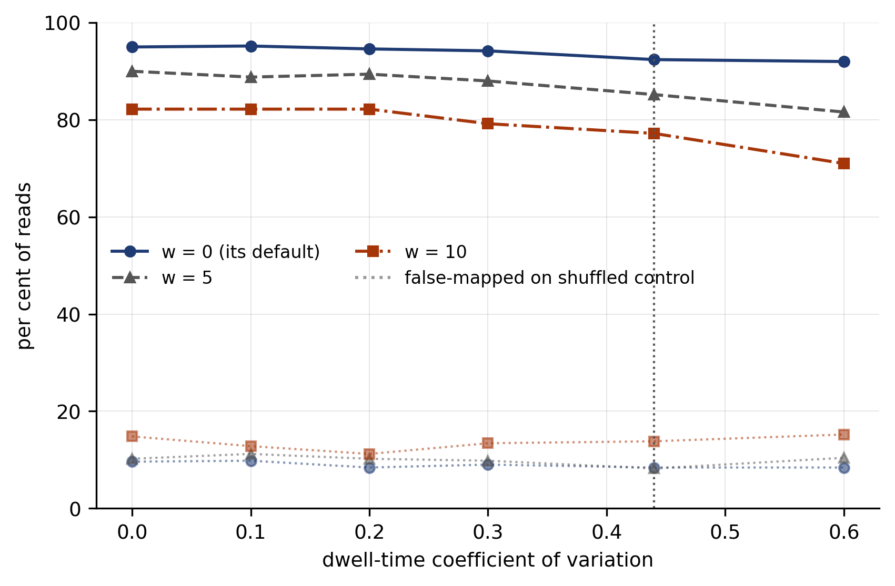
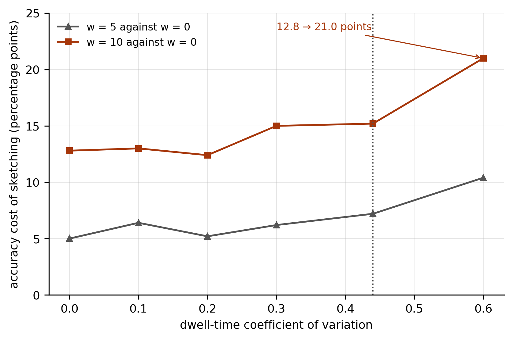

# Time-domain noise as an evaluation axis for raw-signal nanopore mapping

Khushal Singh\*, Ritu Garg

Department of Computer Engineering, National Institute of Technology Kurukshetra, Kurukshetra,
Haryana 136119, India

\*To whom correspondence should be addressed: khushal6002@gmail.com

Article type: Original Paper — Sequence Analysis

---

## Abstract

**Motivation:** Raw-signal nanopore mappers reduce the current trace to discrete events before
matching, so their accuracy depends on how event boundaries respond to variation in the time the
motor protein holds each k-mer in the pore. Mappers are evaluated on real datasets, in which that
dwell-time dispersion is fixed by the sequencing run rather than set by the experimenter, so the
sensitivity of a mapper to it is not measured. Measuring a sensitivity requires moving one
variable while holding the rest constant. No fixed dataset permits that; a signal simulator does.

**Results:** We sweep the dwell-time coefficient of variation (CV) from 0 to 0.60 in Squigulator,
with a composition-matched shuffled control simulated at matching dwell and three generator seeds.
Two segmentation configurations of one quantised-event pipeline reverse their order across the
sweep. Fixed-width segmentation leads event detection at CV 0, 49.7% against 18.4% true-positive
rate at zero false positives, and trails it 10.8-fold at the simulator's default CV of 0.44, 1.3%
against 14.1%; the replicate ranges do not overlap at any dispersion tested. An evaluation at
constant dwell therefore selects the worse configuration. RawHash2 under the same sweep loses 3.0
points at its default setting, which bounds the reversal as a property of the segmentation choice
and not of signal-space mapping. RawHash2's minimizer sketching does carry a dwell-dependent cost:
the accuracy penalty of window 10 against window 0 is 12.8 points at CV 0 and 21.0 at CV 0.60,
where sketching also raises the false-mapping rate on the control from 8.4% to 15.2%. A sketching
trade-off measured at one dispersion therefore does not transfer to another, and one measured on
constant-dwell signal understates it.

**Availability and implementation:** The sweep harness, every result file, the figure generator,
a patch that adds lognormal dwell variation to the Icarust read-until simulator, and a script that
recomputes every number in this article from the committed results are available at
https://github.com/khushal6001-maker/microsecond-readuntil.

**Contact:** khushal6002@gmail.com

---

## 1 Introduction

Signal-space mappers align a nanopore current trace to a reference without basecalling. UNCALLED
(Kovaka et al., 2021) matches events against an FM-index of the reference; Sigmap (Zhang et al., 2021)
indexes event-value seeds in a k-d tree and chains them; RawHash (Firtina et al., 2023) and
RawHash2 (Firtina et al., 2024) hash quantised event k-mers and chain the resulting anchors; and
Sigmoni (Shivakumar et al., 2024) classifies reads with an r-index over a small current alphabet.
Their principal use is where a decision must be made while the molecule is still in the pore, as
in adaptive sampling (Kovaka et al., 2021; Payne et al., 2021).

Every pipeline in this family begins by dividing the trace into events, each intended to
correspond to one k-mer. The order of stages matters. A key is built from consecutive events, so
a query boundary that does not correspond to one implied by the reference changes the key, and no
later stage can restore it. Event duration is set by the motor protein, whose stepping is
stochastic: the number of samples per k-mer varies from one k-mer to the next, and its
distribution is right-skewed. The accuracy of a segmentation-based mapper is therefore a function
of dwell-time dispersion. What is not known, for any published pipeline or parameter choice, is
how strong that dependence is.

Evaluation practice does not measure it. Mappers are evaluated chiefly on real datasets, and RawBench
(Eris et al., 2025), which decomposes raw-signal analysis into reference encoding, signal encoding
and representation matching and evaluates combinations of them, does so on real datasets as well.
In a real dataset dispersion is a property of the run. The experimenter neither sets it nor, in
general, reports it, and two datasets differ in more than dispersion. Each published accuracy
figure is therefore one point at an unknown position on an axis whose slope has not been measured.
CRANE (Ambrozak et al., 2026) corrects errors in raw signal before analysis and reports gains for
existing raw-signal tools, which shows directly that signal-level error propagates to mapping
accuracy; it does not isolate time-domain noise as a variable.

**Why simulation is the instrument.** A sensitivity is a derivative, and measuring one requires
moving the variable while everything else is held. A fixed biological dataset supplies a single
value of dwell dispersion, which cannot be changed without also changing the sample, the pore, the
chemistry or the run. Squigulator (Gamaarachchi et al., 2024) exposes dispersion directly, as the
standard deviation of the number of samples per base, with a documented default of mean 9.0 and
standard deviation 4.0 samples, a CV of approximately 0.44. For this question simulation is not a
substitute for real data but the only instrument with the required control. What simulation cannot
establish, the correspondence between a simulator setting and the dispersion of a particular device
or run, is stated as a limitation in Section 5 rather than assumed.

The question has a practical edge. Icarust (Munro et al., 2024), the simulator that serves the
MinKNOW read-until interface and so allows a client to be tested end to end, emits a fixed number
of samples for every k-mer, which is the CV = 0 case exactly. The one setting in which a read-until
client can be exercised end to end is therefore the one setting in which a dwell-sensitive failure
cannot appear.

This article makes five contributions.

1. A protocol for sweeping dwell dispersion as an evaluation variable, with a composition-matched
   negative control simulated at matching dwell, three generator seeds, and three compatibility
   conditions, each of which, when violated, produces a plausible curve that measures something
   else (Section 2).
2. A ranking reversal: two segmentation configurations of one pipeline exchange order between
   CV 0 and CV 0.10, so that an evaluation at constant dwell selects the configuration that is
   10.8-fold worse at the simulator's default (Section 3.1).
3. A bounding result: RawHash2 does not show the reversal, which locates it in the segmentation
   choice rather than in the method class (Section 3.2).
4. A dwell-dependent accuracy cost of minimizer sketching in RawHash2, which we have not found
   measured elsewhere (Section 3.3).
5. A patch that adds lognormal dwell variation to Icarust, so that live read-until testing can
   exercise the axis (Section 3.4).

**What this article does not claim.** It does not claim that published mappers segment by fixed
time windows; none of those surveyed does. The fixed-width arm is a configuration of the authors'
own pipeline, included because it is the configuration a constant-dwell evaluation favours. It does
not claim that signal simulators omit dwell variation: Squigulator models it, and the gap identified
here is specific to Icarust. It does not claim that the authors' pipeline is competitive. At CV 0.44
its better configuration resolves 14.1% of reads at zero false positives, where RawHash2 maps 91.8%
correctly at its default operating point, and every comparison drawn below concerns the shape of a
system's response to dispersion, not its level.

## 2 Methods

### 2.1 Signal generation

Reads were simulated with Squigulator under its R10.4 PromethION DNA profile (dna-r10-prom), which
samples at 5 kHz. The dwell mean was fixed at 10.0 samples per base and the dwell standard deviation
swept over {0, 1, 2, 3, 4.4, 6} samples, giving CV ∈ {0.00, 0.10, 0.20, 0.30, 0.44, 0.60}. The mean
is held fixed so that only dispersion varies; a varying mean would also change the number of bases
a chunk of fixed duration contains, and so confound dispersion with the quantity of evidence at the
decision point. Each cell was simulated with three generator seeds (42, 43 and 44) and contains 500
on-target reads and 500 control reads.

### 2.2 Reference, pore model and control

The reference is a 20 Mb prefix of human chromosome 20 (GRCh38), indexed together with its reverse
complement, 40 Mb of encoded sequence in all. The pore model is Squigulator's own R10.4 9-mer table,
extracted from its source, and is used both to generate signal and to encode the reference in both
systems under test. The negative control is a composition-matched shuffle of the same reference,
simulated at the same dwell setting as the on-target set in each cell. Composition and dwell are
therefore identical between the two sets, and the only difference between them is whether the
sequence is present in the index.

### 2.3 Three compatibility conditions

Each of the following was violated in a first attempt during this work, and each violation produced
a smooth, plausible curve. They are stated because they apply to any comparison of this kind.

*The pore model must be the same in the generator and in both encoders.* The R10 9-mer table
shipped with Icarust and the table built into Squigulator differ, so encoding the reference with
one while generating signal from the other measures model mismatch rather than dispersion.

*Both strands must be indexed.* Squigulator samples reads from both strands, while reference
encoding is defined on the forward sequence. Indexing one strand makes about half of all reads
unmappable by construction and halves every true-positive rate for a reason unrelated to the axis.

*Chunk length must be defined in time.* The decision procedure consumes chunks of fixed duration.
At this profile's 5 kHz, 0.4 s is 2000 samples; a sample count carried over from a profile with a
different sampling rate misaligns the decision point and changes the evidence available at it.

A sensitivity curve is meaningful only to the extent that everything other than the swept variable
is invariant, and these are invariances that no error message reports.

### 2.4 Configurations under test

Both arms are configurations of one quantised-event read-until pipeline written by the authors, and
both are available in the repository. The *fixed-width* arm divides the trace into windows of a
constant number of samples and builds keys of 14 events at 3 bits per event, sketched with minimizer
window 10. The *detected* arm segments with a two-window t-test changepoint detector (window 4
samples, threshold 3.0, minimum event length 4 samples) and builds keys of 12 events at 4 bits per
event, with minimizer window 1. Both decide after 10 chunks of 2000 samples, 0.4 s each, with signal
scaling estimated from the first chunk, as the pipeline does in live operation. The detector
threshold was calibrated on Squigulator signal (Section 3.5).

The reported statistic is the true-positive rate (TPR) at the lowest score threshold that admits no
control read, that is, at zero false positives. This threshold is set by the single highest-scoring
control read, so it has high variance when the TPR is low; for that reason we report the range over
seeds alongside the mean.

### 2.5 Comparison mapper

RawHash2 v2.1 was run on the same SLOW5 files, given the same pore model through `-p`, `-k 9` and
`--level_column 1`, and otherwise run at its defaults (`-q 4 -e 8 --sig-diff 0.35`) except for the
minimizer window, w ∈ {0, 5, 10}; w = 0, sketching off, is the default. A read is counted as correctly mapped if it
maps within 500 bases of the locus Squigulator records in the read identifier, on the matching
strand, and the false-mapping rate is the percentage of control reads that receive any mapping.

Two differences from Section 2.4 limit what may be compared. RawHash2's default operating point
admits false mappings, so its correct-mapping rate is not level-comparable with a zero-false-positive
TPR; the comparison is of shape. RawHash2 also receives whole reads rather than the first 10 chunks,
which favours it. The dwell × window grid of Table 2 is one seed per cell with 500 reads per set. The
default configuration at CV 0.44 was replicated over seeds 42, 43 and 44, giving 91.8% [91.2–92.4]
correctly mapped and 9.1% [8.4–10.6] false-mapped.

### 2.6 Per-event agreement

To test whether a flat accuracy curve reflects a flat encoding, we measured agreement between
reference and query symbol sequences for both systems with one estimator. Each system's quantised
symbols were dumped for the read and for the reference span at its true locus. For RawHash2 the
read side comes from its own `--out-quantize` option; the reference side comes from
`--out-quantize-ref`, which a patch supplied in the repository adds, since the stock reference path
emits no symbols. The two sequences were aligned, agreement was taken as matches over aligned pairs under the maximising
alignment, and the indel fraction as gap columns over all alignment columns. Both of this pipeline's
segmentations were measured with keys of 12 events at 4 bits per event, so the fixed-width row
isolates the segmentation change from the 3-bit key of the fixed-width arm in Table 1, and scaling
was estimated from the whole read. The measurement covers 200 reads per cell, at CV 0 and CV 0.44
only, with one seed.

### 2.7 Reproducibility

Every number in this article is recomputed from the committed result files by
`scripts/verify_dwell_journal_numbers.py`, which uses decimal arithmetic with round-half-up, checks
every numeral in this text and in its LaTeX source against the recomputed set, and exits non-zero
on any disagreement. The script also lists the values in Section 3.5 that no captured run backs.
Figures are drawn by `scripts/generate_thesis_figures.py` from the same files and from nothing else.

## 3 Results

### 3.1 Constant dwell reverses the ranking of two segmentation configurations

Table 1 and Figure 1 give the TPR of both arms across the sweep. The fixed-width arm falls from 49.7%
at CV 0 to 1.3% at CV 0.44, a 38.2-fold reduction, and is already reduced 8.4-fold at CV 0.10, the
smallest non-zero dispersion tested. The detected arm remains between 14.1% and 19.3% up to CV 0.44
and declines to 7.5% at CV 0.60.

**Table 1.** True-positive rate (%) at zero false positives, mean [range] over three seeds, 500
on-target and 500 control reads per cell.

| Dwell CV | Fixed-width (3 × 14, w = 10) | Detected (4 × 12, w = 1) |
|---|---|---|
| 0.00 | 49.7 [49.2–50.2] | 18.4 [17.0–19.8] |
| 0.10 | 5.9 [5.4–6.6] | 19.3 [15.2–23.0] |
| 0.20 | 1.7 [1.2–2.0] | 17.9 [17.2–19.0] |
| 0.30 | 2.3 [1.4–4.2] | 15.5 [12.6–18.8] |
| 0.44 | 1.3 [1.0–1.6] | 14.1 [13.0–15.0] |
| 0.60 | 1.7 [0.4–3.4] | 7.5 [7.2–8.0] |

**Figure 1.** True-positive rate at zero false positives against dwell-time CV for the two
segmentation configurations. Bars span the observed range over three seeds. The shaded band marks
the interval in which the two curves cross; the dotted line marks Squigulator's default dispersion.

The two arms exchange order between CV 0 and CV 0.10. The replicate ranges do not overlap at any
dispersion tested: at CV 0 the lowest fixed-width replicate, 49.2, exceeds the highest detected
replicate, 19.8, and at every non-zero dispersion the highest fixed-width replicate falls below the
lowest detected one. The order therefore holds in every seed and not only in the means.

The consequence is for configuration selection. An evaluation conducted at CV 0 selects the
fixed-width arm, which leads by 2.7-fold there and trails by 10.8-fold at CV 0.44. This is not an
error of the kind that more data would correct, because every measurement available at CV 0
supports it. The fixed-width arm is not a published method, and the finding concerns the choice
between two configurations of one pipeline under a mis-specified evaluation. Section 3.2 shows that
it does not extend to the method class.

### 3.2 A published mapper does not reverse

At its default, w = 0, RawHash2's correct-mapping rate goes from 95.0% at CV 0 to 92.0% at CV 0.60,
a loss of 3.0 points, with no crossover and no collapse (Table 2, Figure 2). The sensitivity found in
Section 3.1 is therefore a property of fixed-width segmentation and not of quantised-event matching,
and a developer evaluating RawHash2 at constant dwell would reach the same conclusion as one
evaluating it at realistic dispersion. With sketching enabled the decline is steeper, 8.4 points at
w = 5 (90.0 to 81.6) and 11.2 at w = 10 (82.2 to 71.0), which is the subject of Section 3.3.

**Table 2.** RawHash2 across the dwell sweep: percentage of on-target reads correctly mapped and
percentage of control reads mapped at all, by minimizer window w. One seed per cell, 500 reads per
set.

| Rate | w | 0.00 | 0.10 | 0.20 | 0.30 | 0.44 | 0.60 |
|---|---|---|---|---|---|---|---|
| Correct | 0 | 95.0 | 95.2 | 94.6 | 94.2 | 92.4 | 92.0 |
| Correct | 5 | 90.0 | 88.8 | 89.4 | 88.0 | 85.2 | 81.6 |
| Correct | 10 | 82.2 | 82.2 | 82.2 | 79.2 | 77.2 | 71.0 |
| False-mapped | 0 | 9.6 | 9.8 | 8.4 | 9.0 | 8.4 | 8.4 |
| False-mapped | 5 | 10.2 | 11.2 | 10.2 | 9.8 | 8.2 | 10.4 |
| False-mapped | 10 | 14.8 | 12.8 | 11.2 | 13.4 | 13.8 | 15.2 |

**Figure 2.** RawHash2 under the dwell sweep. Solid, dashed and dash-dotted lines: percentage of
on-target reads correctly mapped, by minimizer window. Dotted lines: percentage of control reads mapped. The
default operating point is not zero-false-positive, so these rates are not level-comparable with
Figure 1.

The response to dispersion is visible in the encoding before any seeding or chaining (Table 3).
RawHash2's per-event agreement is 0.913 at CV 0 and 0.911 at CV 0.44, and that of the detected arm
0.797 and 0.783. The fixed-width segmentation's agreement falls from 0.793 to 0.648, and its indel
fraction rises 2.8-fold, from 0.073 to 0.208. RawHash2's indel fraction also rises, from 0.055 to
0.092, without a corresponding loss of agreement. Both segmenters that detect level changes thus
have dispersion-invariant agreement, and the one that segments by time does not. These are two
dwell levels, 200 reads and one seed (Section 5).

**Table 3.** Per-event agreement and indel fraction between reference and query symbol sequences,
one estimator applied to both systems, 200 reads per cell, one seed.

| System | Segmentation | Dwell CV | Agreement | Indel fraction |
|---|---|---|---|---|
| This pipeline | fixed-width | 0.00 | 0.793 | 0.073 |
| This pipeline | fixed-width | 0.44 | 0.648 | 0.208 |
| This pipeline | detected | 0.00 | 0.797 | 0.170 |
| This pipeline | detected | 0.44 | 0.783 | 0.196 |
| RawHash2 | own, with merging | 0.00 | 0.913 | 0.055 |
| RawHash2 | own, with merging | 0.44 | 0.911 | 0.092 |

### 3.3 The cost of minimizer sketching depends on dwell dispersion

Table 4 and Figure 3 give the accuracy cost of sketching, the correct-mapping rate at w = 0 minus
that at a larger window, in percentage points. At w = 10 the cost is 12.8 points at CV 0 and 21.0 at
CV 0.60, an increase of 8.2 points, or 64%. At CV 0.60 sketching at w = 10 also raises the
false-mapping rate on the control from 8.4% to 15.2%, so both error types worsen together. At w = 5
the cost goes from 5.0 to 10.4 points over the same range.

**Table 4.** Accuracy cost of minimizer sketching in RawHash2, w = 0 minus the stated window, in
percentage points of correctly mapped reads, from Table 2.

| Window | 0.00 | 0.10 | 0.20 | 0.30 | 0.44 | 0.60 |
|---|---|---|---|---|---|---|
| w = 5 | 5.0 | 6.4 | 5.2 | 6.2 | 7.2 | 10.4 |
| w = 10 | 12.8 | 13.0 | 12.4 | 15.0 | 15.2 | 21.0 |

**Figure 3.** Accuracy cost of minimizer sketching in RawHash2 against dwell-time CV, for windows 5
and 10 relative to window 0. The dotted line marks Squigulator's default dispersion.

**The growth is not monotone, and the claim is limited accordingly.** At w = 10 the series dips by
0.6 points at CV 0.20, from 13.0 to 12.4. Each cell is one seed. As a scale for single-cell
variation, the three-seed range of the default configuration at CV 0.44 is 1.2 points (91.2 to 92.4),
and a cost is a difference of two such cells. A 0.6-point change is within that scale and an 8.2-point
change is not. The claim made is that the cost is substantially larger at the top of the range than
at the bottom, not that it rises at every step.

**What is known and what is added.** RawHash2 ships with sketching disabled to obtain its highest
accuracy, and reports that its minimizer mode maps with accuracy similar to the default except on the
human genome, at higher throughput (Firtina et al., 2024). That a trade-off exists is therefore known
and documented. What the sweep adds is that its accuracy side is a function of dispersion. A window
chosen from a comparison at one dispersion carries a different cost at another, and a comparison on
constant-dwell signal understates it.

**A candidate mechanism, not isolated.** A minimizer is the key of lowest rank within a window of
consecutive keys (Roberts et al., 2004). A displaced event boundary changes the quantised values of
the keys that overlap it and can therefore change which key in a window attains the minimum, so that
reference and query select different keys even where both would match individually. This requires
boundaries to move. At constant dwell the cost reflects only the seeds that sketching discards; the
increment above it is consistent with the mechanism, which would be demonstrated by recording which
keys each side selects, and that was not done.

### 3.4 Icarust emits constant dwell, and a patch that removes the restriction

Icarust's signal loop emits `samples_per_base` samples for every k-mer, and a source comment notes
that the count could instead be derived from the profile's dwell mean. Its output is therefore the
CV = 0 case exactly, and no configuration of the stock simulator produces time-domain noise.

The patch in `third_party_patches/icarust-dwell-variability.patch` reads a CV from the environment
variable `ICARUST_DWELL_CV` and draws each k-mer's dwell from a lognormal distribution about
`samples_per_base`, with σ² = ln(1 + CV²) and μ = ln(`samples_per_base`) − σ²/2, so that the mean
before rounding equals `samples_per_base` and the CV equals the requested value. Each draw is rounded
and clamped to at least 1 sample, since a k-mer contributing nothing is a skip, which is a different
phenomenon, and to at most 8 times nominal, beyond which a hold is a pore block rather than a dwell.
Unset or 0, the variable reproduces the stock behaviour exactly, so existing results are unaffected.
An environment variable keeps the change minimal and revertible; a version offered upstream should
read the value from the sample profile.

<!-- provisional:begin -->
### 3.5 Secondary observations not backed by a captured run †

The three observations in this section were made during development. Each rests in part on a
measurement for which no run output was captured. Those values are marked with a dagger; none of them
is used in any claim in Sections 3.1 to 3.4 or in the Abstract, and the verification script lists each as
outstanding.

**Live accept rates against Icarust.** With the same client, reference and run length, the
fixed-width arm accepted 43.5%† of reads and the detected arm 9.6%† against stock Icarust, and 0.5%†
and 9.6%† against the patched simulator at CV 0.35. Taken at face value, stock Icarust reports the
fixed-width arm as 4.5-fold† better, and the patched simulator reverses the order, which is the
reversal of Section 3.1 observed on the live interface. These are accept rates on the live loop and
are not comparable with the offline TPRs of Table 1. Re-running stock and patched Icarust against the
client would settle them.

**Calibration target for event detection.** The calibrated detector, threshold 3.0, emits 1562
events per on-target read at CV 0.44, against an ideal of approximately 2000, one event per base,
which is 21.9% under-segmentation; seed 42 gives 14.2% TPR in the captured log. In a development run
that was not captured, threshold 2.0 gave 2017† events per read, close to the ideal, and 2.0%† TPR,
7.1-fold† lower. An argument offered during development attributed the difference to frame
displacement: a spurious boundary shifts every later key in the read. That argument does not
distinguish the two error types, because a missed boundary removes an event and shifts every later
event index by one exactly as a spurious boundary adds one. A sufficient explanation is simpler. The
event count measures net error, insertions minus deletions, and is blind to errors that cancel, so a
detector that emits the ideal number of events may still place many boundaries wrongly. The
recommendation that follows does not depend on the uncaptured values: calibrate a detector against
agreement or indel fraction (Section 2.6), not against its event count.

**Calibration transfer between generators.** A detector threshold calibrated against signal from a
generator written for this project, applied unchanged to Squigulator signal, gave 0.6%† TPR at CV 0,
where the Squigulator-calibrated detector gives 18.4% [17.0–19.8], a 30.7-fold† difference. The two
generators differ in their amplitude-noise models, and the detector threshold is a t-statistic whose
operating point depends on that model. Whatever the magnitude, a result obtained with event detection
is interpretable only together with a statement of how the detector was calibrated and on what
signal.
<!-- provisional:end -->

## 4 Discussion

The sweep makes visible a variable that a point evaluation holds fixed at an unknown value, and in
the two cases measured here the variable decides the outcome. In Section 3.1 it decides which of two
configurations is better; in Section 3.3 it decides how much a documented trade-off costs. Neither
result depends on the authors' pipeline being accurate, since the first concerns the relative order
of two configurations and the second is measured on RawHash2.

We draw six recommendations for evaluating raw-signal methods.

1. **Report dispersion with accuracy.** For simulated signal, report the generator's dwell
   parameters. For real signal, report an estimate of dwell dispersion, which could be obtained from
   basecaller move tables, since these record the samples assigned to each base.
2. **Report a sweep, not a point,** for any method or parameter that depends on segmentation.
3. **Compare configurations at the dispersion of the intended data.** A comparison at CV 0 can
   reverse a ranking (Section 3.1).
4. **Treat the sketching window as dispersion-dependent,** and measure its cost at the dispersion
   of the intended data (Section 3.3).
5. **State the calibration target and calibration signal of any event detector,** and calibrate
   against agreement rather than event count (Section 3.5).
6. **Test read-until clients against a simulator with a dwell model** (Section 3.4).

The sweep is complementary to existing benchmarks. RawBench varies the components of the pipeline on
fixed data; the sweep varies one property of the data with the pipeline fixed, and adding a
simulated-dispersion axis to a modular benchmark would combine the two. It is equally a way to
quantify methods that correct signal before segmentation: the benefit of a correction such as CRANE
could be reported as a function of the noise source it addresses rather than at one point. Any
pipeline that builds keys from consecutive events, whether by hashing quantised values or by seeding
on event vectors, is exposed to boundary placement in the way Section 3.3 describes, and the sweep is
an inexpensive way to measure that exposure.

## 5 Limitations

*One reference and one profile.* All figures derive from a 20 Mb prefix of one human chromosome under
one R10.4 profile. Reference size affects specificity and hence absolute rates; the claim is the
shape of the response to dispersion, and it has not been tested on a second reference.

*Simulated signal only.* The mapping from Squigulator's dwell parameter to the dispersion of any
particular device or run is not established here. Measuring the empirical dispersion of a public
dataset and marking it on the axis is the most direct extension.

*Replication.* The RawHash2 dwell × window grid is one seed per cell. Its default configuration is
replicated at one dwell level, which provides the scale used in Section 3.3 but not a per-cell
interval.

*Mechanisms.* The minimizer mechanism of Section 3.3 is consistent with the data and not isolated.
The agreement measurement of Section 2.6 covers two dwell levels, 200 reads and one seed.

*Absolute level of the detected arm.* The detected configuration's indel fraction is 0.170 already at
CV 0, where there is no timing noise to explain it, which indicates a structural mismatch between
this pipeline's reference and query encodings. It lowers that arm's absolute TPR, and it is one
reason we draw only comparisons of shape.

*Operating points.* The two systems are measured at different operating points, zero false positives
for the authors' pipeline and RawHash2's default for RawHash2.

*Scope of the reversal.* The fixed-width arm is a configuration of the authors' pipeline. No
published tool's evaluation is claimed to be wrong.

## 6 Conclusion

Dwell-time dispersion is a signal property that Squigulator exposes as a parameter and that published
evaluations of raw-signal mappers do not vary. Sweeping it, with a composition-matched control and
three replicates, shows that an evaluation at constant dwell can select a segmentation configuration
that is 10.8-fold worse at realistic dispersion, and that the accuracy cost of minimizer sketching in
RawHash2 rises from 12.8 to 21.0 points over the range swept. The first result is bounded by
RawHash2's flat response and the second is measured on it. Both follow from holding fixed a variable
that evaluation can move, and both are avoided by reporting accuracy as a function of it.

## Funding

[Funding statement to be completed by the authors before submission.]

## Conflict of interest

None declared.

## Data availability

All result files, raw logs, the sweep harness, the figure generator, the Icarust and RawHash2
patches and the verification script are in the repository given under Availability and
implementation.

## References

Ambrozak, S., McConnell, U., Srinivasan, B., Ozkan, B., Zhang, E. and Firtina, C. (2026) CRANE:
correcting errors in raw nanopore signals using hidden Markov models. arXiv:2603.20420.

Eris, F., McConnell, U., Firtina, C. and Mutlu, O. (2025) RawBench: a comprehensive benchmarking
framework for raw nanopore signal analysis techniques. In *Proceedings of the ACM Conference on
Bioinformatics, Computational Biology, and Health Informatics (ACM-BCB)*. arXiv:2510.03629.

Firtina, C., Mansouri Ghiasi, N., Lindegger, J., Singh, G., Cavlak, M.B., Mao, H. and Mutlu, O.
(2023) RawHash: enabling fast and accurate real-time analysis of raw nanopore signals for large
genomes. *Bioinformatics*, **39**(Suppl. 1), i297–i307. doi:10.1093/bioinformatics/btad272.

Firtina, C., Soysal, M., Lindegger, J. and Mutlu, O. (2024) RawHash2: mapping raw nanopore signals
using hash-based seeding and adaptive quantization. *Bioinformatics*, **40**(8), btae478.
doi:10.1093/bioinformatics/btae478.

Gamaarachchi, H., Ferguson, J.M., Samarakoon, H., Liyanage, K. and Deveson, I.W. (2024) Simulation of
nanopore sequencing signal data with tunable parameters. *Genome Research*, **34**(5), 778–783.
doi:10.1101/gr.278730.123.

Kovaka, S., Fan, Y., Ni, B., Timp, W. and Schatz, M.C. (2021) Targeted nanopore sequencing by
real-time mapping of raw electrical signal with UNCALLED. *Nature Biotechnology*, **39**(4), 431–441.
doi:10.1038/s41587-020-0731-9.

Munro, R., Wibowo, S., Payne, A. and Loose, M. (2024) Icarust, a real-time simulator for Oxford
Nanopore adaptive sampling. *Bioinformatics*, **40**(4), btae141. doi:10.1093/bioinformatics/btae141.

Payne, A., Holmes, N., Clarke, T., Munro, R., Debebe, B.J. and Loose, M. (2021) Readfish enables
targeted nanopore sequencing of gigabase-sized genomes. *Nature Biotechnology*, **39**(4), 442–450.
doi:10.1038/s41587-020-00746-x.

Roberts, M., Hayes, W., Hunt, B.R., Mount, S.M. and Yorke, J.A. (2004) Reducing storage requirements
for biological sequence comparison. *Bioinformatics*, **20**(18), 3363–3369.
doi:10.1093/bioinformatics/bth408.

Shivakumar, V.S., Ahmed, O.Y., Kovaka, S., Zakeri, M. and Langmead, B. (2024) Sigmoni: classification
of nanopore signal with a compressed pangenome index. *Bioinformatics*, **40**(Suppl. 1), i287–i296.
doi:10.1093/bioinformatics/btae213.

Zhang, H., Li, H., Jain, C., Cheng, H., Au, K.F., Li, H. and Aluru, S. (2021) Real-time mapping of
nanopore raw signals. *Bioinformatics*, **37**(Suppl. 1), i477–i483. doi:10.1093/bioinformatics/btab264.
